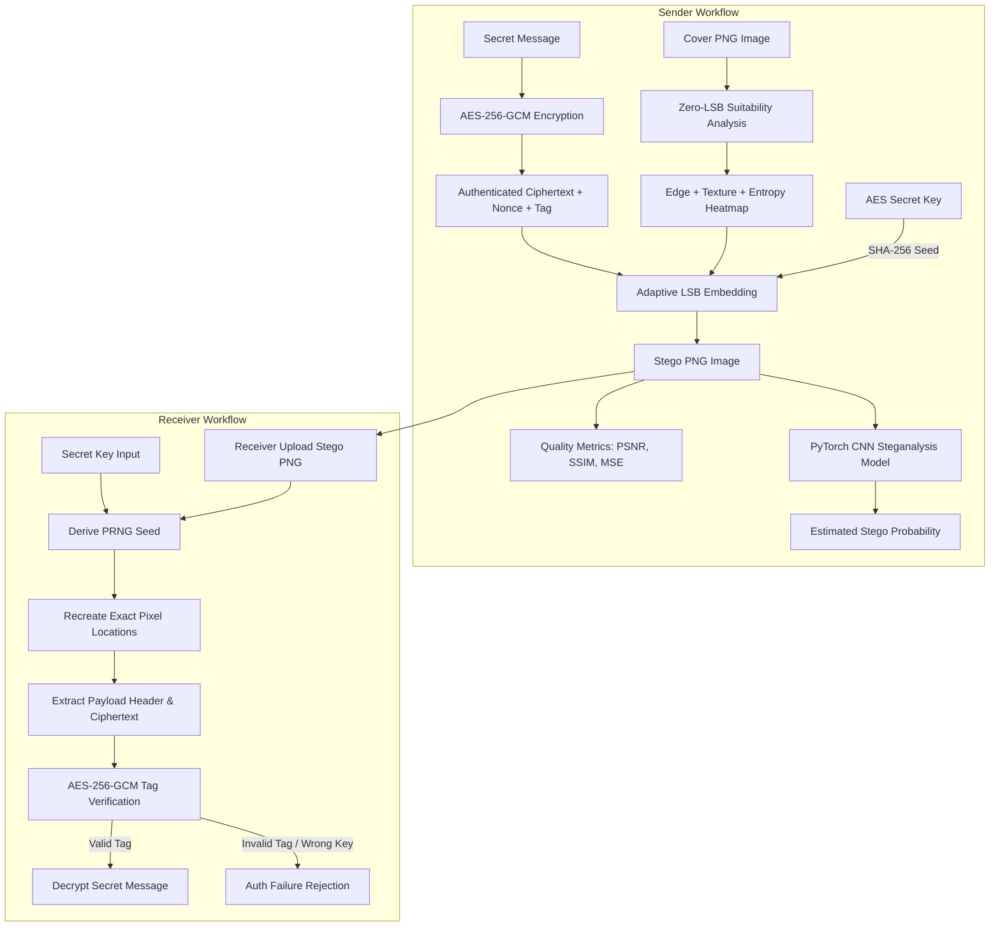

# AI-Driven Adaptive Steganography with Secure Encryption and Intelligent Steganalysis

**A Final-Year Engineering Research & Prototype Platform**

[](https://www.python.org/)
[](https://fastapi.tiangolo.com/)
[](https://pytorch.org/)
[](https://react.dev/)
[](https://www.typescriptlang.org/)
[](https://tailwindcss.com/)

---

## 📌 Abstract & Project Objective

Modern covert communications require both **data confidentiality** and **cover signal concealment**. Traditional LSB steganography embeds payload bits uniformly, creating spatial statistics anomalies easily detected by deep-learning steganalysis tools.

This project delivers a complete, production-grade full-stack system implementing a **Three-Level Security Architecture**:
1. **Level 1 — Confidentiality**: AES-256-GCM authenticated encryption with 256-bit random key generation, 12-byte IV/nonce, and 16-byte authentication tag.
2. **Level 2 — Concealment**: Zero-LSB multi-factor adaptive image analysis (Sobel edge magnitude, local variance texture, Shannon block entropy) with key-derived deterministic PRNG payload placement.
3. **Level 3 — Detectability Assessment**: A PyTorch Convolutional Neural Network initialized with Spatial Rich Model (SRM) noise residual high-pass filters for estimating model-based stego detection probability.

---

## 🏗️ System Architecture



---

## 🛠️ Technology Stack

### Backend
- **Framework**: FastAPI (Python 3.11)
- **Cryptography**: PyCryptodome (`AES.MODE_GCM`, `secrets.token_hex`)
- **Image Processing**: OpenCV (`cv2`), Pillow (`PIL`), NumPy, scikit-image (`compare_ssim`)
- **Machine Learning**: PyTorch (`torch.nn`), scikit-learn (`accuracy`, `f1_score`, `roc_auc_score`)
- **Server**: Uvicorn

### Frontend
- **Framework**: React 18 + TypeScript + Vite
- **Styling**: Tailwind CSS + Custom Cyberpunk / Dark Glassmorphism tokens
- **Icons**: Lucide React
- **Charts**: Recharts (PSNR vs Payload, Model Benchmarks)
- **HTTP Client**: Axios

---

## 📐 Mathematical Formulation

### 1. Zero-LSB Invariant Suitability Score
To ensure the receiver computes an identical suitability map after embedding, feature extraction is executed on the zero-LSB plane ($I_{zero} = I \ \& \ \text{0xFE}$):
$$\text{Suitability}(x, y) = 0.40 \cdot \text{Sobel}(I_{zero}) + 0.30 \cdot \text{Variance}(I_{zero}) + 0.30 \cdot \text{Entropy}_{8\times 8}(I_{zero})$$

### 2. Peak Signal-to-Noise Ratio (PSNR)
$$\text{MSE} = \frac{1}{H \times W \times C} \sum_{x,y,c} (I(x,y,c) - K(x,y,c))^2$$
$$\text{PSNR} = 20 \cdot \log_{10} \left( \frac{255}{\sqrt{\text{MSE}}} \right) \text{ dB}$$

---

## 🚀 Installation & Running

### Prerequisites
- **Python 3.11+** installed and available on PATH
- **Node.js v18+ & npm** installed

### 1. Setup Backend (FastAPI + PyTorch)
```powershell
cd backend

# Install dependencies
pip install -r requirements.txt

# Run automated backend unit tests & train baseline PyTorch CNN
python test_backend.py

# Start FastAPI backend server (runs on http://127.0.0.1:8000)
python run.py
```

### 2. Setup Frontend (React + Vite)
In a new terminal tab:
```powershell
cd frontend

# Install npm packages
npm install

# Start Vite development server (runs on http://localhost:3000)
npm run dev
```

Open `http://localhost:3000` in your web browser.

---

## 🧪 Demonstration Scenario for Project Viva

1. **Sender Workflow**:
   - Open **Secure Message** page.
   - Enter text `"Meet me at 5 PM."`.
   - Upload sample cover image (`data/samples/sample_cover_1.png`).
   - Click **Execute Encrypt & Embed Workflow**.
   - Copy or download the generated **AES-256 Secret Key**.
   - Inspect PSNR (>70 dB), SSIM (1.0), 10x difference map, and estimated stego probability.
   - Download the generated **Stego PNG Image**.

2. **Receiver Workflow**:
   - Open **Extract Message** page.
   - Upload the downloaded **Stego PNG Image**.
   - Paste the **AES Secret Key**.
   - Click **Extract & Decrypt Payload**.
   - Verify decrypted output: `"Meet me at 5 PM."`.

3. **Security Failure Demonstration**:
   - Change a single character in the secret key -> System displays clean error: `"Authentication failed. Invalid secret key or no valid payload detected in image."`.

4. **Smart 5-Image Recommendation**:
   - Open **Smart Recommendation** page.
   - Upload 3 to 5 images from `data/samples/`.
   - The engine automatically embeds the message into all candidates, calculates PSNR/SSIM/MSE and steganalysis probability, and highlights the recommended candidate with exact rationale.

---

## ⚠️ Documented Project Limitations

1. **Model Dependence**: Steganalysis probability is model-dependent; no system guarantees universal undetectability.
2. **Lossless Requirement**: Lossy compression (e.g. JPEG) alters LSB pixel values and corrupts payload. PNG format is required for lossless LSB steganography.
3. **Out-of-Band Key Exchange**: AES secret key must be communicated securely between sender and receiver out-of-band.

---

## 📜 License
Developed for university academic project viva and research demonstration.
